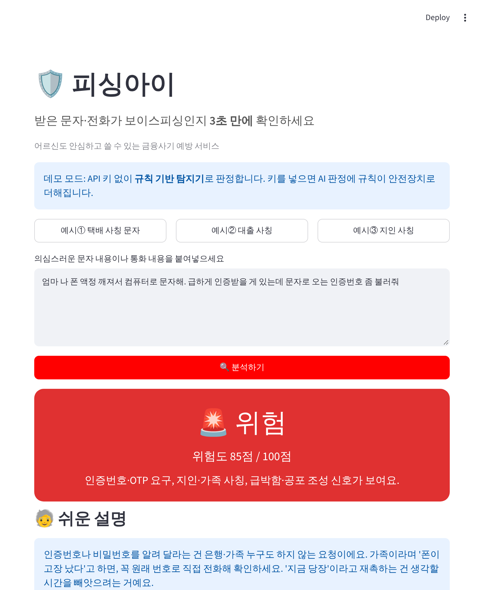
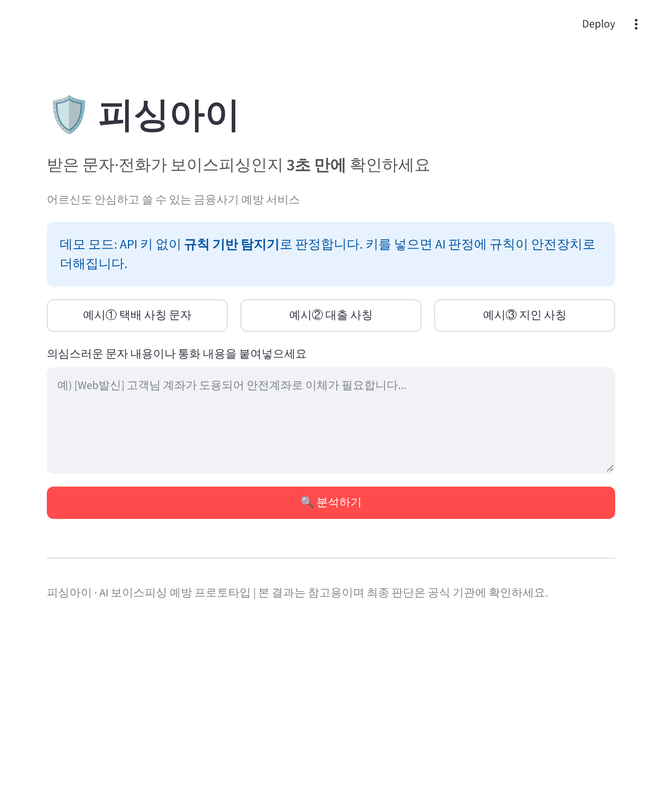
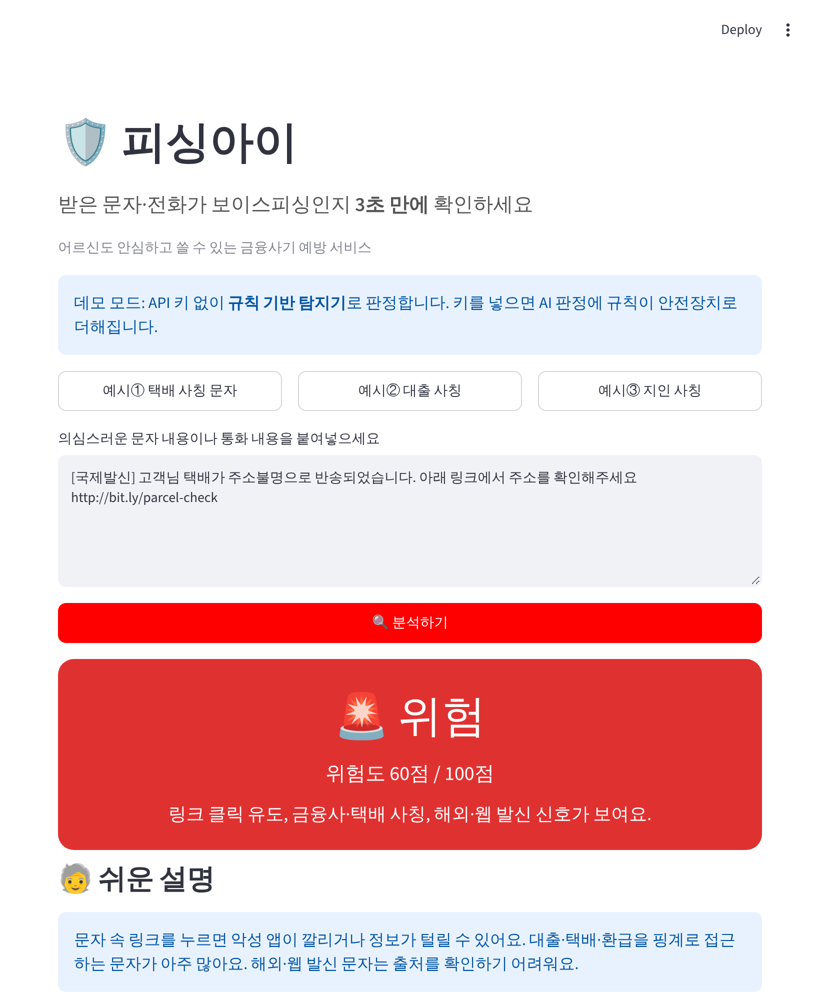

# 🛡️ 피싱아이 (Phishing-Eye)

[](https://github.com/XXXXXim/imbank-ai-challenge/actions/workflows/tests.yml)

> **어르신도 3초 만에 쓰는 보이스피싱·스미싱 판별기**
> 받은 문자나 통화 내용을 붙여넣으면 위험도와 이유, 지금 해야 할 행동을 쉬운 말로 알려 줍니다.
> 금융 AI 공모전 준비 중 만든 시니어 포용금융 프로토타입입니다.



## 왜 만들었나

보이스피싱은 디지털에 익숙하지 않은 어르신이 가장 크게 당합니다. 그런데 기존 안내문은 "의심 문자에 주의하세요" 수준이라, **지금 받은 이 문자가 위험한지**는 알려 주지 않습니다.
피싱아이는 문자를 붙여넣기만 하면 **🚨 위험 / ⚠️ 주의 / ✅ 안전**을 큰 글씨로 보여 주고, 왜 위험한지와 바로 할 일(112·1332 신고, 원래 번호로 확인)을 어르신 말투로 설명합니다.

## 핵심 설계: AI 판정 + 규칙 안전장치

| 상황 | 동작 |
|---|---|
| API 키 있음 | LLM이 판정하고, **규칙 탐지기가 바닥을 지킨다** — LLM이 '안전'이라 해도 규칙이 인증번호 요구·안전계좌 이체 같은 신호를 찾으면 그 등급 아래로 내려가지 않음 |
| API 키 없음 / LLM 오류 | 규칙 탐지기만으로 판정 → **누구나 키 없이 바로 데모 가능**, 서비스가 멈추지 않음 |

사기 판별은 "놓치면 안 되는" 문제라서, 틀리면 안 되는 부분은 모델이 아니라 코드가 지키게 했습니다.

### 규칙 탐지기 (`detector.py`)

10가지 신호에 점수를 매겨 더합니다. 60점 이상 **위험**, 25점 이상 **주의**.

| 신호 | 점수 | 예 |
|---|---:|---|
| 인증번호·OTP 요구 | 45 | "인증번호 좀 불러줘" |
| 앱 설치 유도 | 45 | "앱 설치 후 상담원과 통화" |
| 송금·이체 유도 | 40 | "안전계좌로 이체" |
| 링크 클릭 유도 | 35 | `bit.ly/...` |
| 기관 사칭 · 지인 사칭 · 개인정보 요구 | 각 25 | 검찰·금감원 / "폰 액정 깨져서" / 주민번호 |
| 금융사·택배 사칭 · 급박함 조성 | 각 15 | 저금리 대환대출 / "즉시", "연루" |
| 해외·웹 발신 | 10 | `[국제발신]` |

- **돈·정보·앱 요구가 하나라도 있으면 점수와 상관없이 최소 '주의'** (LLM 프롬프트와 같은 원칙)
- **오탐 줄이기:** '엄마' 같은 호칭만으로는 잡지 않고, "폰 액정이 깨져서 컴퓨터로 문자해" 같은 **사칭 수법 자체**만 봅니다. 그래서 "엄마 오늘 저녁 뭐 먹어?"는 안전으로 나옵니다.

## 화면

| 첫 화면 (키 없이 데모 모드) | 택배 사칭 + 링크 문자 |
|---|---|
|  |  |

## 실행

```bash
pip install -r requirements.txt
streamlit run app.py          # 키 없이 규칙 기반 데모 모드로 실행
```

AI 판정을 쓰려면 `.streamlit/secrets.toml`(또는 환경 변수)에 넣습니다. OpenAI 호환 API면 무엇이든 됩니다.

```toml
API_KEY = "sk-..."            # Upstage면 up_...
BASE_URL = ""                 # Upstage: https://api.upstage.ai/v1
MODEL = "gpt-4o-mini"         # Upstage: solar-pro2
```

## 테스트

```bash
pip install pytest && python -m pytest -q tests
```

사기 문자 4종(택배·대출·지인·검찰 사칭)은 안전으로 나오지 않는지, 일상 문자 3종(가족·친구·병원 예약)은 안전으로 나오는지, LLM이 놓친 신호를 규칙이 끌어올리는지 검사합니다. GitHub Actions에서 PR마다 자동으로 돌아갑니다.

## 한계와 다음 단계

- 규칙은 키워드 기반이라 새로운 수법이나 일부러 띄어쓰기를 바꾼 문장은 놓칠 수 있습니다 → 그래서 LLM과 함께 씁니다.
- 실제 피싱 문자 데이터셋(경찰청·금감원 공개 사례)으로 정탐률·오탐률을 수치로 재는 평가는 아직 하지 않았습니다. 다음 단계로 평가셋을 만들어 규칙 점수를 조정할 계획입니다.
- 판정 결과는 참고용입니다. 의심되면 **경찰 112 · 금융감독원 1332**에 확인하세요.

## 기술 스택

`Python` `Streamlit` `OpenAI 호환 API (OpenAI · Upstage Solar)` `pytest` `GitHub Actions`
